# irtexplorer: Interactive IRT Models and Estimation

## Overview

**irtexplorer** is an R package with an interactive Shiny application, built with [golem](https://thinkr-open.github.io/golem/), for learning and teaching Item Response Theory (IRT). It brings together two earlier apps in one site:

- **modelsirt**, which draws the response curves of the main IRT models, so that you can see how each item parameter shapes them;
- **mleirt**, which shows how abilities and item parameters are estimated, by maximum likelihood and by Bayesian EAP and MAP estimation.

Both were adapted from the **irtDemo** package by Wes Bonifay and Metin Bulus. Every plot is an interactive [plotly](https://plotly.com/r/) chart that is redrawn as soon as a slider moves.

## Features

The app has eleven tabs in two menus.

### Models menu

- **Rasch-4PL**: the item characteristic curve of a dichotomous item under the Rasch, 1PL, 2PL, 3PL and 4PL models, with the name of the model that the parameters define
- **PCM-GPCM**: category response curves of the partial credit and generalized partial credit models
- **GRM**: category response curves of the graded response model
- **RSM-GRSM**: category response curves of the rating scale and generalized rating scale models
- **NRM**: category response curves of the nominal response model, for unordered categories
- **TIRT**: probit response functions of Thurstonian IRT, for forced-choice items and comparative judgments
- **MIRT Dichotomous**: the response surface, contour plot (with the item vector) and information surface of an item that measures two abilities, compensatory or non-compensatory

### Estimation menu

- **MLE Rasch**: the Newton-Raphson method finding a person's maximum likelihood ability, step by step
- **MLE 2PL**: the log-likelihood surface of an item's discrimination and difficulty, from simulated responses, with its maximum
- **MLE 3PL**: the same surfaces for twelve assumed guessing values, to show how guessing affects the estimation
- **EAP-MAP Rasch**: Bayesian estimation of ability by quadrature, with the prior, item trace lines, likelihood and posterior

### Key Capabilities

- **Interactive Parameter Adjustment**: sliders for every item parameter, with the plots redrawn immediately
- **Interactive Plots**: hover for the values, zoom and pan, rotate the 3-D surfaces, and click a legend entry to hide or show a curve
- **Textbook Examples**: the default settings of the Estimation tabs reproduce the results of de Ayala (2009)
- **Functions in R**: every model, estimation method and plot of the app is also an R function

## Installation

### Prerequisites

1. **Install R** (version 4.1 or higher): https://cran.r-project.org/
2. **Install RStudio** (optional but recommended): https://posit.co/downloads/

### Package Installation

Open RStudio (or an R console) and run:

```r
# Install devtools if you haven't already
install.packages("devtools")
# Install irtexplorer from GitHub
devtools::install_github("sedzinfo/irtexplorer")
```

The dependencies (`shiny`, `golem`, `plotly`, `config` and `fGarch`) are installed automatically.

## Usage

Launch the app with two lines of code:

```r
library(irtexplorer)
run_app()
```

The app opens in your default web browser. Any [`shiny::shinyApp()`](https://shiny.posit.co/r/reference/shiny/latest/shinyapp.html) option can be passed on, for example `run_app(options = list(port = 8080))`.

## Using the Functions in R

The models, estimation methods and plots of the app are also available as functions, for scripts, R Markdown reports and teaching material:

```r
library(irtexplorer)

# category response curves of a polytomous item
theta <- seq(-6, 6, by = 0.1)
plot_category_curves(theta, prob_gpcm(theta, a = 1.5), "Generalized Partial Credit Model")
plot_category_curves(theta, prob_grm(theta, b = c(-1.5, 0, 1.5)), "Graded Response Model")

# an item that measures mostly the first of two abilities
grid <- seq(-4, 4, length.out = 50)
a <- c(2, 0.5)
plot_mirt_contour(grid, grid, prob_mirt(grid, grid, a = a), level = 0.5, arrow = item_vector(a))

# Newton-Raphson steps towards the maximum likelihood estimate of ability
nr <- newton_raphson_rasch(response_pattern(2), iterations = 5)
nr$steps[, c("start", "end")]
plot_newton_raphson(nr)

# EAP and MAP estimates with 40 quadrature points
estimate <- eap_map(response_pattern(2), quadrature = 40)
c(EAP = estimate$eap, MAP = estimate$map)
plot_eap_combined(estimate)
```

The help page of `run_app()` describes every tab, with the formulas of the models and what each control and plot shows.

## Screenshots

### Rasch-4PL
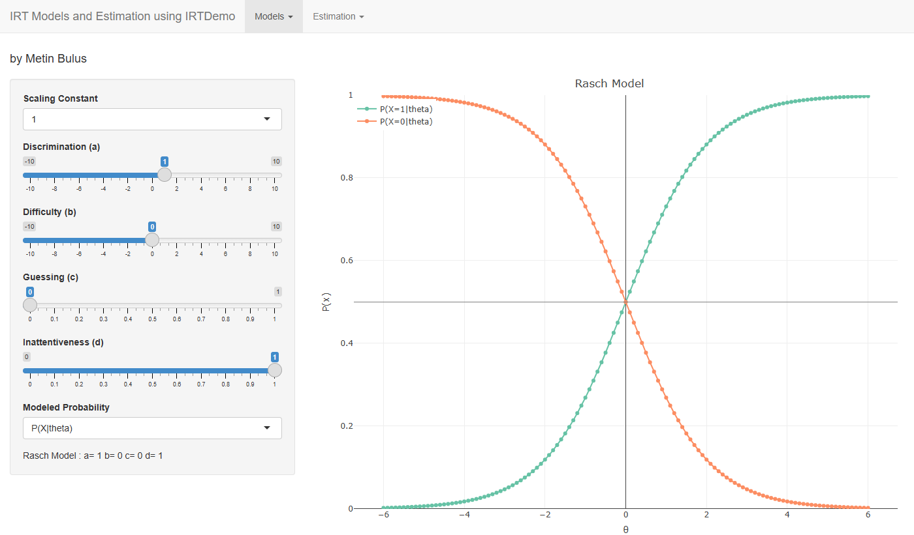

### PCM-GPCM
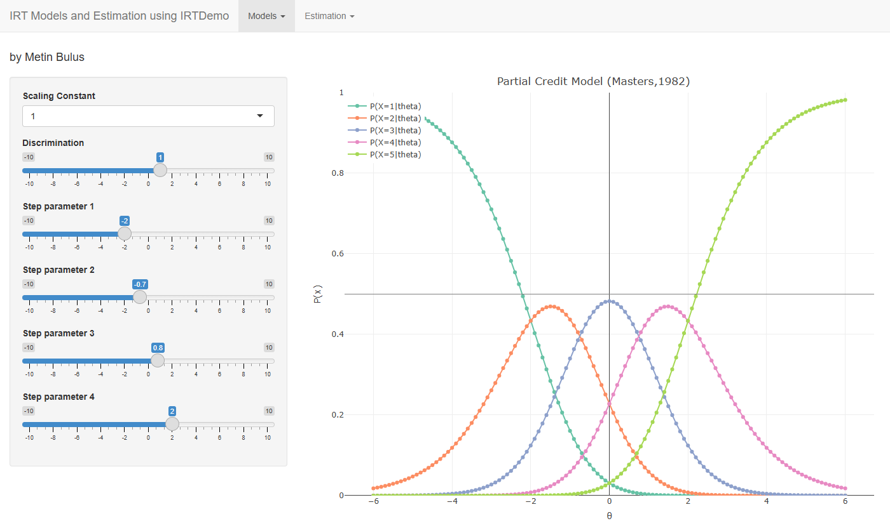

### GRM
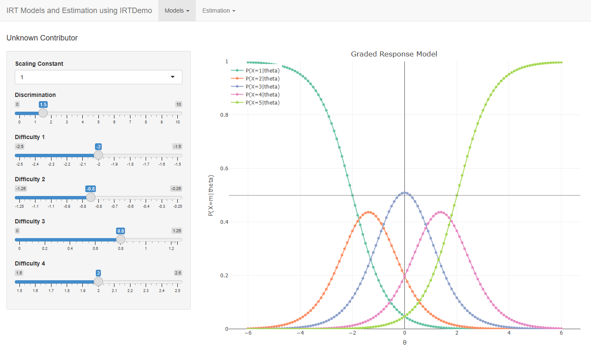

### RSM-GRSM
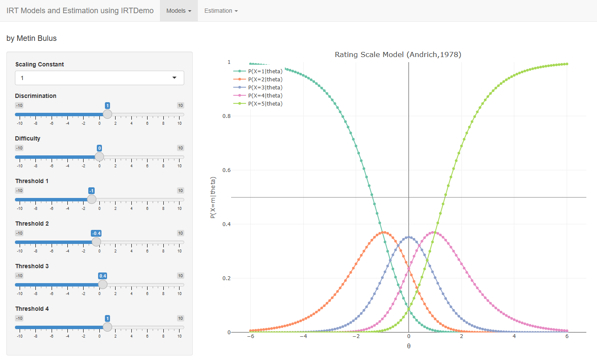

### NRM
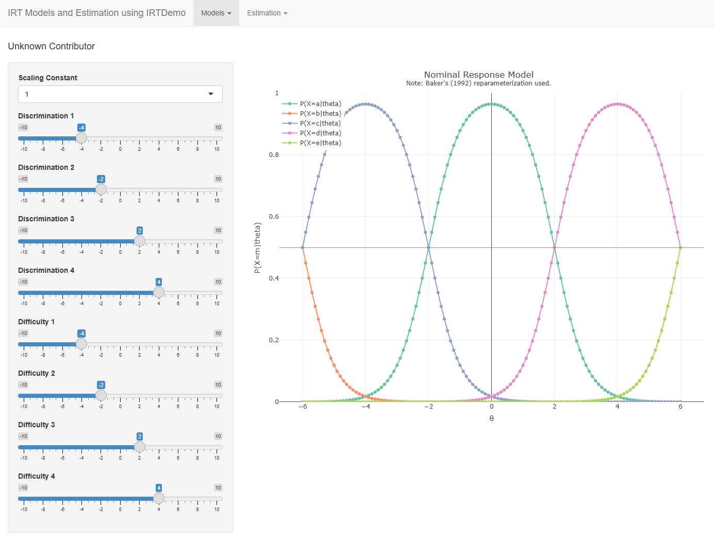

### TIRT
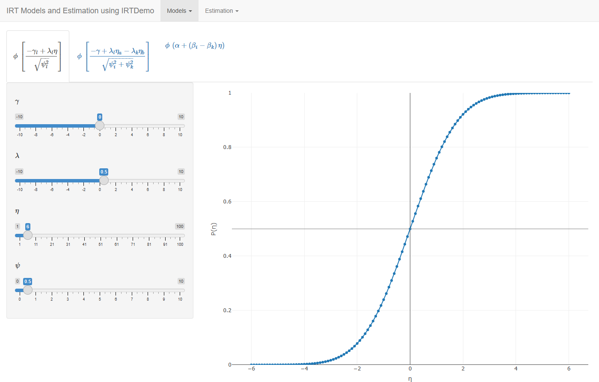

### MIRT Dichotomous
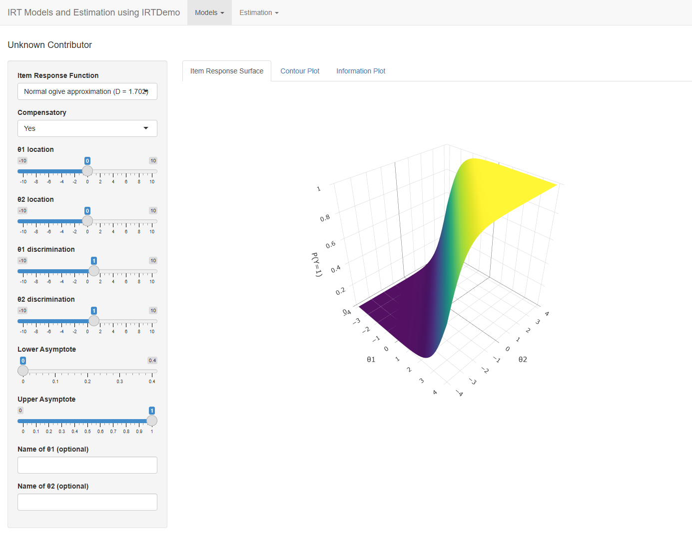
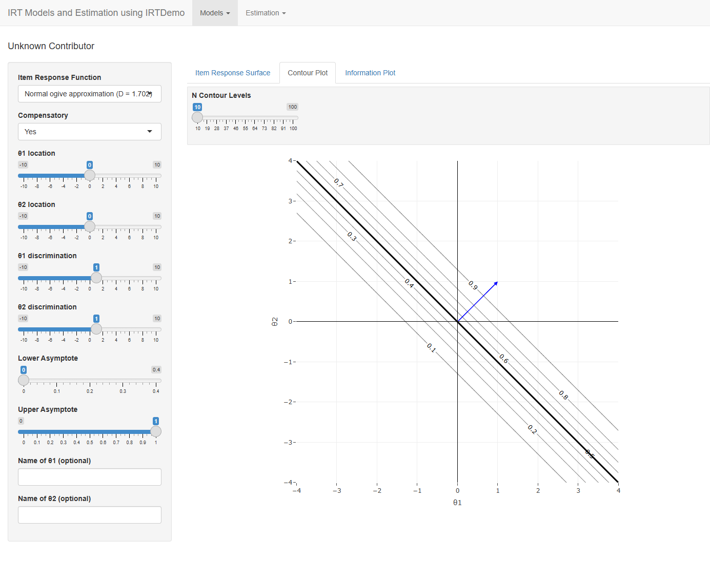

### MLE Rasch
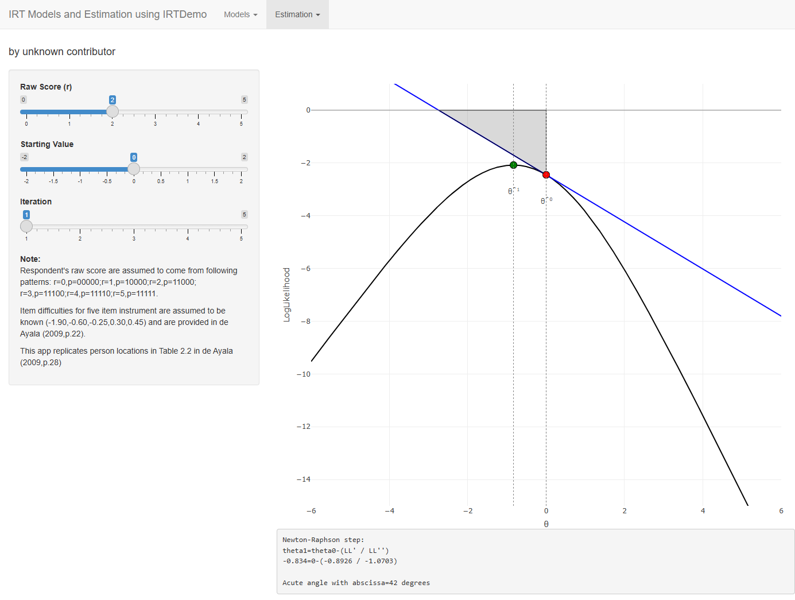

### MLE 2PL
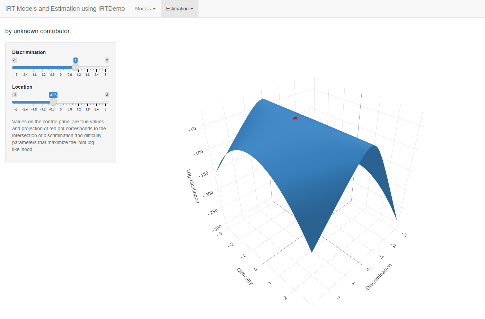

### MLE 3PL
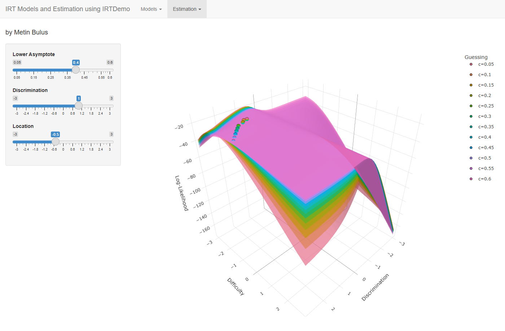

### EAP-MAP Rasch
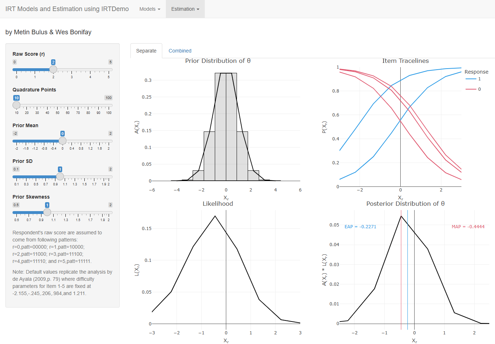
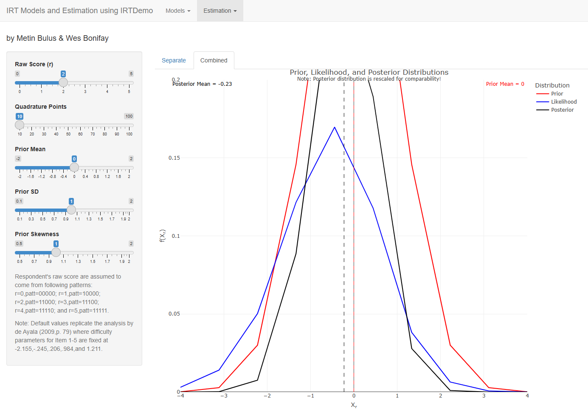

## Development

The package follows the layout of a [golem](https://thinkr-open.github.io/golem/) app:

| File | Contents |
|---|---|
| `R/run_app.R` | `run_app()`, which starts the app, with the help page that describes every tab |
| `R/app_ui.R`, `R/app_server.R` | The navigation bar with the two menus, and the server, which starts the modules |
| `R/mod_*.R` | One Shiny module per tab |
| `R/fct_models.R` | The response functions of the models |
| `R/fct_estimation.R` | Log-likelihoods, Newton-Raphson steps, and EAP and MAP estimation |
| `R/fct_plots.R` | The plotly charts |
| `R/utils_helpers.R` | Small helpers shared by the modules and charts |
| `R/app_config.R`, `inst/golem-config.yml` | The golem configuration |
| `inst/app/www/` | The favicon |
| `tests/testthat/` | Tests of the functions, the modules and the page |

Run the tests with `devtools::test()`, and the full package check with `devtools::check()`. `generate_package.R` documents, tests and installs the package, and builds the website, the PDF manual and the tarball.

### Deploying to shinyapps.io

`app.R` starts the app on [shinyapps.io](https://www.shinyapps.io/), and `.rscignore` keeps the upload to the files the app needs.

1. Connect your account once, with the `rsconnect::setAccountInfo()` line from Account, Tokens on shinyapps.io.
2. Run `rsconnect::deployApp(appName = "irtexplorer")` from the package folder, or open `app.R` in RStudio and click Publish.

## Background and Attribution

The plots were originally developed by **Wes Bonifay** and **Metin Bulus** for the **irtDemo** package, which is available on CRAN. **Dimitrios Zacharatos** modified and expanded them in the modelsirt and mleirt packages, which irtexplorer brings together as one golem app:

- consolidating the IRT models and estimation methods into a single interface
- rebuilding the visualisations with Plotly for interactivity
- adding further IRT models
- improving the user interface

Special thanks to [Kostas Maistrelis](https://github.com/maisk) for contributing the implementation of the Thurstonian IRT curves. Each tab keeps the credit shown in the original apps.

**Original Authors**: Wes Bonifay and Metin Bulus  
**Current Maintainer**: Dimitrios Zacharatos  
**Original CRAN Package**: [irtDemo](https://cran.r-project.org/package=irtDemo)

## References

- Andrich, D. (1978). A rating formulation for ordered response categories. *Psychometrika*, 43(4), 561-573.
- Baker, F. B. (1992). *Item Response Theory: Parameter Estimation Techniques*. Marcel Dekker.
- Bulus, M., & Bonifay, W. (2022). irtDemo R Package: Pedagogical Interactive Web Applications for Estimation, Scoring, and Multi Dimensionality in Item Response Theory. *Anadolu University Journal of Education Faculty*, 6(1), 92-108. https://doi.org/10.34056/aujef.913781
- de Ayala, R. J. (2009). *The Theory and Practice of Item Response Theory*. Guilford Press.
- Magis, D. (2013). A note on the item information function of the four-parameter logistic model. *Applied Psychological Measurement*, 37(4), 304-315.
- Masters, G. N. (1982). A Rasch model for partial credit scoring. *Psychometrika*, 47(2), 149-174.
- Muraki, E. (1990). Fitting a polytomous item response model to Likert-type data. *Applied Psychological Measurement*, 14(1), 59-71.
- Muraki, E. (1992). A generalized partial credit model: Application of an EM algorithm. *Applied Psychological Measurement*, 16(2), 159-176.

## License

GPL-3. See the [LICENSE](LICENSE) file for details.

## Contributing

Contributions, issues, and feature requests are welcome! Feel free to check the [issues page](https://github.com/sedzinfo/irtexplorer/issues).

---


